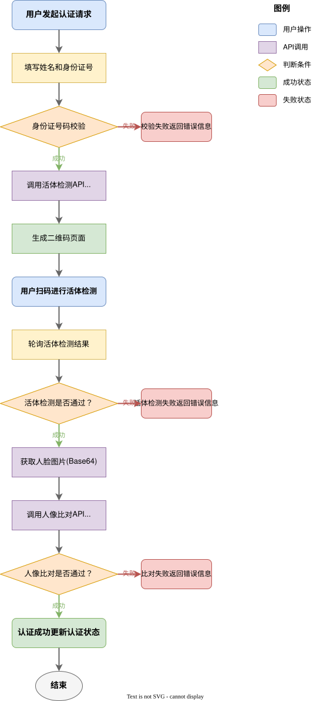

# 魔方财务 FurryFace 人脸实名认证插件

## 插件简介

FurryFace 是一款基于阿里云市场 API 的智简魔方（魔方财务）人脸实名认证插件，支持活体检测与人像比对功能。该插件可集成至支持插件化认证流程的系统中，为用户提供安全、便捷的实名认证体验。

## 功能特性

- **活体检测**：支持摇头、点头、左转头、右转头、眨眼、张嘴等多种动作检测，有效防止照片、视频等伪造攻击
- **人像比对**：将活体检测采集的人脸与身份证照片进行比对，验证身份真实性
- **多端支持**：H5 页面支持手机浏览器、微信、小程序等多种场景
- **灵活配置**：支持自定义活体检测动作、页面样式、安全策略等参数
- **个人/企业认证**：同时支持个人认证与企业认证流程（企业认证开发中）

## 界面展示

### 后台配置界面


### 前端认证界面

**扫描二维码进行认证**


**认证成功**


## 安装说明

### 安装目录

```
/public/plugins/certification/furryface
```

### 目录结构

```
furryface/
├── FurryfacePlugin.php      # 插件主类
├── config.php               # 后台配置项定义
├── qrcode.min.js            # 二维码生成库
├── config/
│   └── config.php           # 默认配置（API地址等）
├── controller/
│   └── CertifyController.php # 控制器（回调、轮询）
├── logic/
│   └── Furryface.php        # 核心业务逻辑
└── faceresult/              # 人脸图片存储目录（可选）
```

### 安装步骤

1. 将插件目录上传至 `/public/plugins/certification/furryface`
2. 在后台插件管理中启用 FurryFace 插件
3. 配置阿里云市场 API 的 AppCode（详见下方配置说明）

## 配置说明

### 必填配置

| 配置项 | 说明 | 获取方式 |
|--------|------|----------|
| 活体检测 AppCode | 活体检测 API 的授权码 | [阿里云市场-活体检测](https://market.aliyun.com/detail/cmapi00071987) |
| 人像比对 AppCode | 人像比对 API 的授权码 | [阿里云市场-人像比对](https://market.aliyun.com/detail/cmapi00066582) |

### 活体检测配置

| 配置项 | 说明 | 默认值 |
|--------|------|--------|
| 活体检测页面标题 | 采集页面的标题文本 | FurryCloud人脸认证 |
| 活体检测样式 | 样式1：头部+局部动作随机组合；样式2：仅局部动作 | 样式1 |
| 活体检测动作 | 自定义动作，逗号分隔（LookLeft/LookRight/OpenMouth/BlinkEye/ShakeHead/NodHead） | 默认随机 |
| 动作互斥检测 | 开启后动作不匹配立即停止采集 | 关闭 |
| 防摄像头劫持 | 开启闪光防摄像头劫持检测 | 关闭 |
| 显示成功结果页 | 是否展示采集成功的结果页 | 显示 |
| 显示失败结果页 | 是否展示采集失败的结果页面 | 显示 |
| 隐藏引导页 | 是否隐藏活体检测引导页 | 显示 |
| 前端活体算法 | 开启前端小模型活体算法 | 开启 |
| 云端活体算法 | 开启云端大模型活体算法 | 关闭 |

### 其他配置

| 配置项 | 说明 | 默认值 |
|--------|------|--------|
| 保存用户人脸图片 | 是否将用户人脸图片保存到服务器本地 | 不保存 |
| 金额 | 认证收费金额，大于0时需要支付 | 0 |
| 免费认证次数 | 用户可免费认证的次数 | 0 |

---

## 使用的市场接口的 API 接口文档

### 1. 活体检测 - 获取 Token

**接口路径**：`/api/liveness/h5/token`  
**请求方法**：POST  
**请求地址**：`https://kzlive.market.alicloudapi.com`

#### 请求头

| 参数名 | 类型 | 必填 | 说明 |
|--------|------|------|------|
| Authorization | string | 是 | 格式：`APPCODE {your_appcode}` |
| Content-Type | string | 是 | `application/x-www-form-urlencoded; charset=UTF-8` |

#### 请求参数

| 参数名 | 类型 | 必填 | 说明 |
|--------|------|------|------|
| returnUrl | string | 是 | 活体检测完成后的跳转地址 |
| title | string | 否 | 页面标题，最长32字符 |
| style | string | 否 | 样式：1-头部+局部动作；2-仅局部动作 |
| actionLiveList | string | 否 | 动作列表：LookLeft,LookRight,OpenMouth,BlinkEye,ShakeHead,NodHead |
| actionMutex | string | 否 | 动作互斥：true/false |
| antiCameraHack | string | 否 | 防摄像头劫持：true/false |
| showSuccess | string | 否 | 显示成功页：true/false |
| showFail | string | 否 | 显示失败页：true/false |
| hideGuidePage | string | 否 | 隐藏引导页：true/false |
| foreLiveOn | string | 否 | 前端活体算法：true/false |
| backLiveOn | string | 否 | 云端活体算法：true/false |

#### 返回值

```json
{
    "code": 200,
    "msg": "成功",
    "data": {
        "orderNo": "20240101123456789012",
        "url": "https://xxx.com/h5/live?token=xxx"
    }
}
```

#### 错误码

| 错误码 | 说明 |
|--------|------|
| 200 | 成功 |
| 400 | 参数错误 |
| 403 | AppCode 无效或已过期 |
| 500 | 服务器内部错误 |

---

### 2. 活体检测 - 获取结果

**接口路径**：`/api/liveness/h5/result`  
**请求方法**：POST  
**请求地址**：`https://kzlive.market.alicloudapi.com`

#### 请求头

| 参数名 | 类型 | 必填 | 说明 |
|--------|------|------|------|
| Authorization | string | 是 | 格式：`APPCODE {your_appcode}` |
| Content-Type | string | 是 | `application/x-www-form-urlencoded; charset=UTF-8` |

#### 请求参数

| 参数名 | 类型 | 必填 | 说明 |
|--------|------|------|------|
| orderNo | string | 是 | 活体检测订单号 |

#### 返回值

```json
{
    "code": 200,
    "msg": "成功",
    "data": {
        "orderNo": "20240101123456789012",
        "result": 0,
        "desc": "活体检测通过",
        "faceImageUrl": "https://xxx.com/face.jpg"
    }
}
```

#### result 状态说明

| 值 | 说明 |
|----|------|
| 0 | 活体检测通过 |
| 1 | 活体检测不通过 |
| 2 | 等待检测/检测中 |

---

### 3. 人像比对 - 身份证人脸比对

**接口路径**：`/api-mall/api/face_id_card_yi_suo/check`  
**请求方法**：POST  
**请求地址**：`https://kzfacev1.market.alicloudapi.com`

#### 请求头

| 参数名 | 类型 | 必填 | 说明 |
|--------|------|------|------|
| Authorization | string | 是 | 格式：`APPCODE {your_appcode}` |
| Content-Type | string | 是 | `application/x-www-form-urlencoded; charset=UTF-8` |

#### 请求参数

| 参数名 | 类型 | 必填 | 说明 |
|--------|------|------|------|
| name | string | 是 | 真实姓名 |
| idcard | string | 是 | 身份证号码 |
| image | string | 是 | 人脸图片 Base64 编码 |

#### 返回值

```json
{
    "code": 200,
    "msg": "成功",
    "data": {
        "resultCode": 1001,
        "msg": "比对通过",
        "score": 0.95
    }
}
```

#### resultCode 状态说明

| 值 | 说明 |
|----|------|
| 1001 | 比对通过，确认为同一人 |
| 1002 | 相似度较低，无法确认为同一人 |
| 1003 | 比对结果为不同人 |
| 1004 | 比对失败（其他原因） |

#### 错误码

| 错误码 | 说明 |
|--------|------|
| 200 | 成功 |
| 400 | 参数错误（姓名、身份证号格式错误等） |
| 403 | AppCode 无效或已过期 |
| 500 | 服务器内部错误 |

---

## 认证流程



流程图源文件：[img/认证流程图.drawio](img/认证流程图.drawio)（可使用 draw.io 或 diagrams.net 打开编辑）

---

## 关于阿里云市场 API

本插件使用的 API 服务来自阿里云市场，选择该服务的原因如下：

### 活体检测 API

- **市场地址**：https://market.aliyun.com/detail/cmapi00071987
- **用户协议**：https://market.aliyun.com/product/protocol.htm?code=cmapi00071987
- **选择理由**：价格实惠，按次计费，支持多种活体动作检测，H5 页面可直接使用，无需额外开发前端采集页面
- **功能特点**：支持摇头、点头、左转头、右转头、眨眼、张嘴等动作检测，防照片、视频攻击

### 人像比对 API

- **市场地址**：https://market.aliyun.com/detail/cmapi00066582
- **用户协议**：https://market.aliyun.com/product/protocol.htm?code=cmapi00066582
- **选择理由**：价格低廉，调用简单，支持身份证二要素+人脸照片比对，返回相似度分数
- **功能特点**：与公安数据库比对，验证身份真实性

### 相关协议

- **阿里云市场服务协议**：https://terms.aliyun.com/legal-agreement/terms/suit_bu1_ali_cloud/suit_bu1_ali_cloud201802011628_45290.html

**注意**：本插件开发者与阿里云市场及 API 提供商无任何关联，仅作为 API 调用方使用相关服务。使用前请务必阅读并同意相关协议。

---

## 免责声明

1. **服务来源**：本插件所使用的活体检测和人像比对服务均来自阿里云市场第三方 API 服务商，插件开发者不对 API 服务的稳定性、准确性、安全性作任何保证。

2. **数据安全**：本插件仅作为 API 调用中间层，不存储用户身份证号、姓名等敏感信息（除非开启本地图片保存功能）。用户敏感数据直接传输至阿里云市场 API 服务商，请确保您已阅读并同意相关服务商的隐私政策。

3. **服务费用**：阿里云市场 API 服务按调用次数收费，费用由 API 服务商收取。使用本插件产生的 API 调用费用与插件开发者无关，请自行关注账户余额及消费情况。

4. **合规使用**：请确保您的使用场景符合国家法律法规要求，获得用户明确授权后方可进行人脸识别和身份验证。因违规使用产生的法律责任由使用者自行承担。

5. **服务变更**：API 服务商可能随时调整服务价格、接口参数或停止服务，插件开发者不对由此产生的影响负责。如遇 API 变更，请关注服务商公告并及时调整配置。

6. **无担保**：本插件按"现状"提供，不提供任何形式的明示或暗示担保，包括但不限于适销性、特定用途适用性等。在任何情况下，插件开发者不对任何直接、间接、偶然、特殊或后果性损害承担责任。

7. **版本更新**：插件可能随时更新以修复问题或添加功能，建议定期检查更新。重大变更将在更新日志中说明。

---

## 反馈与支持

如在使用过程中遇到问题或有改进建议，欢迎通过以下方式反馈：

- **QQ 群**：311971756

---

## 支持项目

如果觉得插件好用，可以给叶淮璟一个 Star 吗 QWQ ⭐

---

## 更新日志

### v1.0.0
- 初始版本发布
- 支持活体检测与人像比对
- 支持个人认证
- 支持自定义活体检测动作和页面样式

---

## 注意

本插件仅供学习交流使用，请勿用于非法用途。
